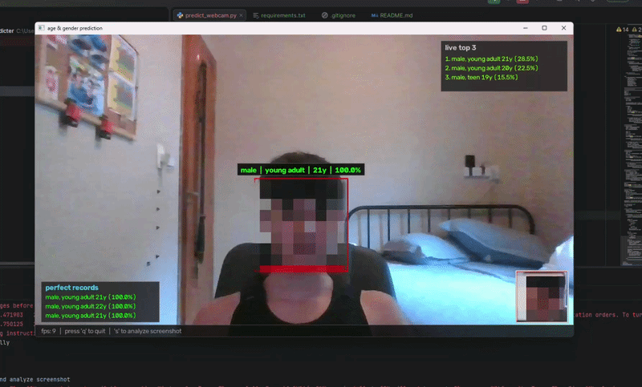

# webcam age & gender predictor 

real-time age and gender prediction from webcam using a custom cnn trained on the utkface dataset.



## what it does

this application opens your webcam, detects your face in real-time, and predicts your estimated age and gender using a deep learning model. it is designed to be stable, visually clean, and informative — no flickering text, no jumping boxes.

## features explained

### live face detection

uses opencv haar cascade classifier to locate faces in the webcam feed. the detection runs on every frame, but the bounding box is smoothed using exponential moving average so it never jitters or flickers, even if the detector misses a frame.

### gender prediction with confidence

the model outputs a probability between 0 and 1. instead of showing raw unstable predictions, the app uses a temporal smoothing buffer (20 frames) and a lock system. once the model is confident enough, the gender "locks" and only changes if another gender achieves a much higher confidence for several consecutive frames.

### age estimation with range labels

instead of showing a raw number like "23" that jumps around constantly, the app maps the numeric age to a human-readable range:

| age | label |
|-----|-------|
| 0-12 | child |
| 13-19 | teen |
| 20-29 | young adult |
| 30-44 | adult |
| 45-59 | middle age |
| 60+ | senior |

this makes the result feel more natural and forgiving, since exact age regression from a single image is inherently imprecise.

### gender lock system (anchor)

**why it exists:** the model is small and trained from scratch on a limited dataset. when running on webcam footage (different lighting, angles, and crops from the training data), it can oscillate between male and female rapidly.

**how it works:**
- the app waits until confidence exceeds 70% to lock the first gender.
- once locked, the displayed gender will **never** drop below that confidence level.
- to switch genders, the new candidate must exceed 92% confidence for 10 consecutive frames.
- this prevents false switches from momentary detection noise.

### perfect records tracker

**why it exists:** during a session, the model may occasionally hit 100% confidence on a specific (gender, age) combination. these moments are rare and interesting — they represent the model's most certain predictions.

**how it works:**
- every time the locked confidence reaches 99.5% or higher, that result is stored.
- up to 3 unique perfect records are kept and displayed in the bottom-left panel.
- they persist until the face leaves the frame for too long.
- this creates a "hall of fame" effect for the session.

### screenshot deep analysis (press `s`)

**why it exists:** the live prediction is fast but uses only one crop per frame. a single frame may have suboptimal lighting or face angle. deep analysis lets you "freeze" a specific moment and run the model 12 times with different augmentations.

**how it works:**
- when you press `s`, the current face crop is saved.
- the app runs 12 predictions with variations:
  - original
  - horizontal flip
  - brightness +15% and -15%
  - contrast +20% and -20%
  - sharpness boost and reduction
  - combined flips + adjustments
  - slight resize artifacts
- results are aggregated by (gender, age) and ranked by frequency.
- a top 3 list from this deep analysis appears in the top-left panel, with a thumbnail of the analyzed face.

this gives a much more robust "second opinion" on a specific frame without slowing down the live feed.

### live top 3 predictions

**why it exists:** over a long session, the model may predict many slightly different ages. showing only the current result hides the overall trend.

**how it works:**
- every locked prediction is recorded.
- the app counts frequency of each unique (gender, age) pair.
- the top 3 most common combinations are shown in the top-right panel with percentage bars.
- this shows what the model "thinks" on average across the entire session.

### face snapshot

a thumbnail of the first detected face is captured and displayed in the bottom-right corner. it serves as a visual reference for who is being analyzed during the session. it resets when the face leaves the frame.

### low light warning

if the average brightness of the frame drops below 60 (0-255 scale), a centered warning appears. poor lighting drastically reduces face detection quality and model accuracy.

### fps counter

shows live frames-per-second in the bottom status bar. useful for verifying that the app is running smoothly on your hardware.

## setup

```bash
pip install -r requirements.txt
```

## usage
place your trained model as age_gender_model.h5 in the project root, then run:
```bash
python predict_webcam.py
```
| key   | action |
|-------|:------:|
| q     |  quit  | 
| s     |  capture screenshot + deep analysis  |

## training

to train your own model on the utkface dataset:

[check the train.py here!](https://github.com/felipeabreu199/Age-and-Gender-Prediction-with-Keras-TensorFlow/blob/main/train.py)

## tech stack

- python 3.12
- tensorflow / keras
- opencv
- numpy + pillow

## notes

the model file (*.h5) is excluded from git via .gitignore due to size. download a pre-trained model or run train_model.py to generate your own. [check the train.py here!](https://github.com/felipeabreu199/Age-and-Gender-Prediction-with-Keras-TensorFlow/blob/main/train.py)

## project structure

```text
Web-Cam-Age-Gender-Predicter/
├── .venv/                  # Virtual environment (not included in Git)
├── assets/                 # Images and other project assets
├── .gitignore              # Git ignore rules
├── age_gender_model.h5     # Trained model
├── predict_webcam.py       # Webcam prediction script
├── README.md               # Project documentation
├── requirements.txt        # Python dependencies
```


